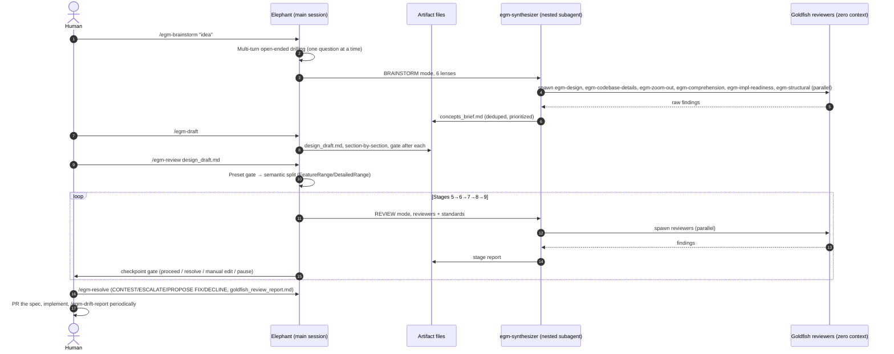
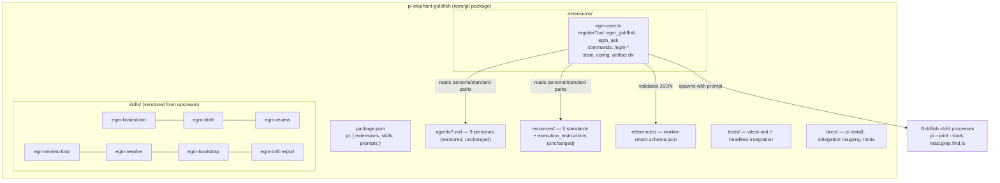
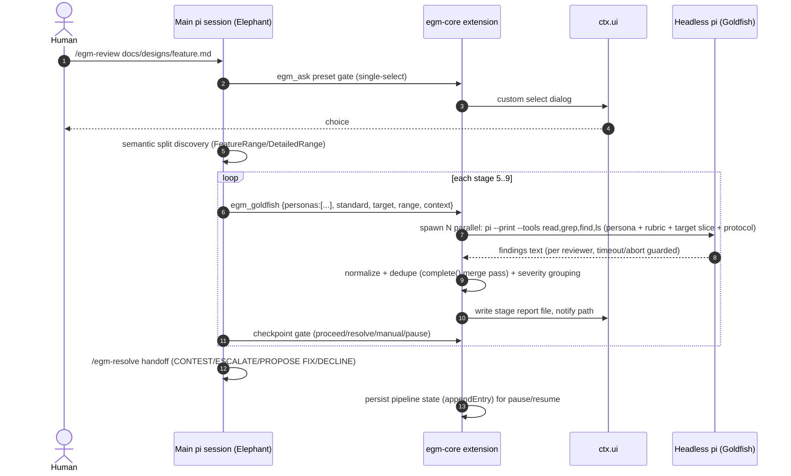

# Port Plan: Elephant-Goldfish Model (EGM) as a Pi Package

**Target:** Re-implement [google/elephant-goldfish-model](https://github.com/google/elephant-goldfish-model) as a Pi coding-agent package (`pi-elephant-goldfish`).
**Upstream reference:** `/home/nicolas/projects/elephant-goldfish-model` @ `a8380ab`
**Status:** Proposal (planning only — no implementation authorized yet).

---

## 1. What EGM is (system examination)

EGM implements Spec-Driven Development: an **Elephant** (deep-context main agent) drafts specs; **Goldfish** reviewers (zero-context subagents) stress-test them; the human approves. Upstream ships one shared content set (`skills/`, `agents/`, `resources/`) consumed by five harnesses (Antigravity, Claude Code/Cowork, Codex, ChatGPT, omp) via per-harness manifests. Upstream policy: *"No harness gets a fork of the skill text"* — harness differences live in manifests + delegation docs.

### 1.1 Subsystem inventory

| # | Subsystem | Location | Mechanics (verified from source) |
|---|-----------|----------|----------------------------------|
| 1 | **Skills layer** (7) | `skills/egm-{brainstorm,draft,resolve,bootstrap,review,review-loop,drift-report}/SKILL.md` | Agent Skills format (`name`, `description`, `license`, `disable-model-invocation: true`). Slash-invoked. Orchestrate workflow, spawn Goldfish, write artifacts (`concepts_brief.md`, `design_draft.md`, `*_report.md`), pause at human gates. |
| 2 | **Personas layer** (9) | `agents/*.md` | Stateless system prompts with `name`+`description` frontmatter → registered by harnesses as named subagents (`egm-design`, `egm-zoom-out`, `egm-synthesizer`, …). Strictly read-only, stateless ("Goldfish isolation"), no chitchat. |
| 3 | **Document standards** (5) | `resources/document_standards/*.md` | Versioned rubrics reviewers load at runtime (feature-spec, heilmeier, implementation-readiness, re-implementation, zoom-out). |
| 4 | **Execution instructions** | `resources/execution_instructions.md` | Design-only scope guard: no production file writes, one-question-at-a-time, explicit consensus gates, contradiction auditing. |
| 5 | **Delegation contract** | Repeated "Delegation" section in every skill | Harness-abstracted subagent spawning: Antigravity `invoke_subagent` (named, nesting), Claude `Agent` (named, ≤3 nesting levels), Codex `spawn_agent` (unnamed → "read persona file first"). **Hard rule:** no subagent tool ⇒ review skills must stop (same-context review is not a Goldfish review). Nesting unavailable ⇒ direct dispatch replaces the synthesizer. |
| 6 | **Synthesizer fan-out/fan-in** | `agents/synthesizer.md` | Intermediate subagent spawns the reviewer swarm in parallel, normalizes/dedupes findings (🔴 Blocker/🟡 Major/🟢 Nit), writes one report, returns a single summary (context pollution guard). |
| 7 | **Interactive gates** | All skills | Single-select question tool (`ask_question`) with strict invariants: exactly 1 question, sole tool call in turn, no "(Recommended)" prefix; open-ended inputs must use plain chat instead. |
| 8 | **Artifact-first UX** | All skills | Large content must go to files, never chat dumps; notify path + yield turn. Working dir or harness artifact dir (configurable via `AGENTS.md` line `EGM artifact directory: .dev/docs`). |
| 9 | **Manifests & packaging** | `plugin.json` (portable Agent Plugins 1.0.0), `.claude-plugin/`, `.codex-plugin/`, `.agents/plugins/marketplace.json`, `distributions/claude/` | Per-harness catalogs; `scripts/pack_plugin.py`, `prepare_release.py`; Claude adapters under `.claude-plugin/agents/` (read-only tool config + context isolation). |
| 10 | **Bootstrap recursion** | `egm-bootstrap` SKILL + `references/worker-return.schema.json` | BFS discovery → >15 dirs safety gate → adaptive partitioning (3–5 branches) → parallel sub-orchestrator workers → JSON `subtree_index` returns → root roll-up → mandatory final verification pass → optional drift review. `goldfish-explorer` scout: read-only, 50KB/300-line caps, test-file filtering. |
| 11 | **Test suite** | `tests/unit/*.py`, `tests/integration/test_{claude,codex}.py` | Pytest: frontmatter validity, packaging/metadata drift, link integrity, scenario coverage, skill load limits, per-harness integration fixtures. |

### 1.2 Original lifecycle (5 phases)

---

## 2. Pi capability mapping

Verified against pi docs (`extensions.md`, `skills.md`, `prompt-templates.md`, `packages.md`, `cli.md`, `configuration.md`) and `examples/extensions/qna.ts`.

| Pi capability | What it gives us | EGM need it satisfies |
|---|---|---|
| **Pi packages** (`pi` key in `package.json`; `pi install git:…`/`npm:…`) | One distributable unit carrying `skills/`, `prompts/`, `extensions/` | Manifest+marketplace+install (upstream `plugin.json` role) |
| **Pi skills** (Agent Skills spec) | EGM skills are *already* spec-compliant; `disable-model-invocation: true` supported; `/skill:name args`; load-on-demand (name+description advertised only) | Skills layer, near byte-identical |
| **Extension commands** (`pi.registerCommand`) | `/egm-brainstorm <args>` UX parity (pi native is `/skill:egm-brainstorm`) | Slash-command surface |
| **Custom tools** (`pi.registerTool`, TypeBox schema) | Model-callable `egm_ask` gate tool; `egm_goldfish` delegation tool | Interactive gates; subagent spawning |
| **`ctx.modelRegistry.complete(model, {systemPrompt, messages})`** | Fresh-context, provider-neutral single call — but **no tools** | Fallback channel for pure-text reviews / merge passes |
| **Headless `pi --print` + `--tools read,grep,find,ls`** | Fresh process = true zero-context agent **with read-only tools** | The Goldfish primitive (file reading + code search reviewers require) |
| **`ctx.ui`** (notify, confirm, `custom()` components) | Terminal dialogs, spinners (BorderedLoader pattern), status | Artifact-first notifications, gates, worker progress |
| **`pi.appendEntry` / tool `details`** | Durable, branch-aware state excluded from context | Review pause/resume pipeline state |
| **`AGENTS.md` support** | Project instruction file loaded by pi | `EGM artifact directory:` convention works unchanged |
| **`child_process` from extension** (runs inside pi process) | Parallel spawn pool with timeout/abort | Synthesizer fan-out/fan-in; bootstrap workers |

**Key design decision — the Goldfish primitive.** Pi core has no named-subagent registry and no in-process nested agent loop exposed to extensions. Two options:

- **(A) Headless `pi --print` subprocess** (recommended): genuinely fresh context, has file tools (reviewers must read docs, standards, and search code — EGM's `zoom-out` and `codebase-details` personas *require* code search), read-only toolset matches EGM's "strictly read-only" mandate, no nesting-recursion risk (do not load our extension in the child), cross-platform.
- (B) `ctx.modelRegistry.complete` with inlined file contents: cheaper, but reviewers lose code search; breaks personas' mandates.

Strategy **A**, with B reserved for the synthesizer's final dedupe/merge normalization pass (pure text work).

---

## 3. Target architecture (Pi port)

### 3.1 Package layout

### 3.2 Runtime sequence (review, Pi port)

**Mechanism notes**

- **Named personas emulated, not registered.** The extension resolves `egm-design` → `agents/design_critic.md` (vendored absolute path) and instructs the child to adopt the persona — exactly upstream's documented fallback for harnesses without named subagent registration.
- **No synthesizer nesting.** Fan-out/fan-in moves into the extension (TypeScript spawn pool). Upstream explicitly sanctions this: *"If your harness cannot nest subagents, use direct dispatch instead of the synthesizer."*
- **Hard-stop rule preserved.** If the `pi` binary is unavailable to the extension, review skills stop with the upstream-mandated message instead of degrading to same-context review.
- **Skill text sync.** The per-skill "Delegation" paragraph is parameterized upstream per harness; we apply a small, scripted adaptation (documented substitution) pointing at the `egm_goldfish`/`egm_ask` tools. Everything else stays byte-identical to upstream; a sync script re-applies adaptations on upstream updates.

---

## 4. Feature parity matrix

| EGM feature | Upstream mechanism | Pi port mechanism | Parity |
|---|---|---|---|
| `/egm-brainstorm` 6-lens shootdown | Skill + synthesizer nesting, 6 parallel Goldfish | Skill + extension fan-out (6 headless spawns) | ✅ Full |
| `/egm-draft` section-by-section drafting | Skill, per-section approval gates | Skill (unchanged) + `egm_ask` gates | ✅ Full |
| `/egm-review` 5-stage pipeline, 4 presets | Skill, nested synthesizer, stage reports | Skill + extension orchestration, stage reports | ✅ Full (orchestration relocated) |
| `/egm-review-loop` sharpening loop | Skill loop driver in Elephant context | Skill (unchanged) | ✅ Full |
| `/egm-resolve` categorization + batch/interactive apply | Skill, file edits | Skill (unchanged), edits via native write/edit tools | ✅ Full |
| `/egm-drift-report` docs-vs-code diff | In-thread skill (no subagents) | Skill (unchanged) | ✅ Full |
| `/egm-bootstrap` recursive README contracts | Recursive sub-orchestrator workers + scout | Extension spawn pool, `is_worker` prompts, schema-validated returns | ✅ Full |
| >15-directory safety gate | Structured question | `egm_ask` gate | ✅ Full |
| Zero-context Goldfish isolation | Fresh subagent context | Fresh `pi --print` process (stronger: process boundary) | ✅ Full |
| Reviewer read-only constraint | Harness tool restrictions | `--tools read,grep,find,ls` | ✅ Full |
| Named persona registration (`egm-design`…) | Harness native registry | Emulated: persona file loaded by child | 🟡 Emulated (same behavior, documented upstream fallback) |
| Synthesizer as nested subagent | Subagent spawns subagents | Extension-side fan-out/fan-in (sanctioned direct dispatch) | 🟡 Adapted |
| Two independent reviewer instances per lens (recall boost) | Synthesizer option | Spawn pool option (trivial: N×2) | ✅ Full |
| Single-select gate invariants (1 question, sole call, no "(Recommended)") | Harness `ask_question` | `egm_ask` tool (invariants enforced by API shape) | ✅ Full |
| Artifact-first delivery + artifact dir | Files / harness artifact panel | Files + `EGM artifact directory:` via AGENTS.md / setting | 🟡 Files only (no side-panel UI; TUI widget possible later) |
| Pause/resume review session | Conversation + reports on disk | Same + `appendEntry` pipeline state (branch-aware) | ✅ Full |
| `disable-model-invocation` | Supported | Supported natively by pi | ✅ Full |
| Plugin marketplace install | Harness marketplaces | `pi install git:`/`npm:` + `pi-package` gallery keyword | ✅ Full |
| Multi-harness single content source | One repo, many manifests | Pi-specific package; scripted upstream sync; optional upstream PR | 🟡 Divergence risk (mitigated by sync script / upstream contribution) |
| `openai.yaml` display metadata, icons | Codex/ChatGPT UI | `package.json` metadata; no icon channel (cosmetic) | 🟢 Partial/cosmetic |
| Upstream test suite (frontmatter, links, packaging, integration) | Pytest | Ported as vitest checks + headless end-to-end fixture | 🟡 Ported in Phase 5 |

---

## 5. Phased implementation plan

Each phase closes with a work-unit commit and runnable checks.

### Phase 0 — Scaffold & decisions (small)
- Initialize package: `package.json` with `pi: { extensions: ["extensions/*.ts"], skills: ["skills/*"], … }`, `pi-package` keyword, peerDependencies on host-provided packages (`*`, unbundled), Apache-2.0 license + attribution to upstream.
- Pin upstream revision (`a8380ab`) in `UPSTREAM.md`; add `scripts/sync-upstream.sh`.
- Decide (needs your input): npm name/scope; standalone-first vs upstream-PR-first (recommendation below).
- **Accept:** `pi -e ./` loads the empty extension without errors.

### Phase 1 — Content vendoring & adaptation layer (medium)
- Vendor `skills/`, `agents/`, `resources/` from upstream (byte-identical except the scripted Delegation-paragraph substitution and `${CLAUDE_PLUGIN_ROOT}`/path references → skill-relative, which pi resolves natively).
- Rewrite per-skill delegation text to name `egm_goldfish` / `egm_ask` and the hard-stop rule.
- Unit checks: frontmatter validity, link integrity across vendored files (port of upstream `test_frontmatter.py`, `test_link_integrity.py`).
- **Accept:** all 7 skills discoverable (`/skill:egm-draft` loads), links resolve.

### Phase 2 — Core extension runtime (medium, the heart)
- `egm_ask` tool: single-select gate via `ctx.ui.custom`; API-enforced invariants; plain-chat fallback guidance when `ctx.hasUI` is false (JSON/print modes).
- `egm_goldfish` tool: input = persona shortnames/paths, standard, target file, range/semantic target, GoldfishContext list, mode; spawns headless `pi --print --tools read,grep,find,ls` pool with concurrency cap, per-child timeout, abort-signal wiring; collects findings; optional `complete()` merge/dedupe pass; writes report file; returns summary + path (never dumps content).
- Config: artifact directory (setting + `AGENTS.md` convention), model/timeout overrides.
- **Accept:** a scripted fixture spawns one real reviewer on a sample doc and produces a findings report.

### Phase 3 — Orchestration layer (medium)
- Commands `/egm-review`, `/egm-review-loop`, `/egm-resolve`, `/egm-brainstorm`, `/egm-draft`, `/egm-drift-report` (UX aliases that load the vendored skill with args).
- Review pipeline state machine: presets (interactive/uninterrupted/feature-spec/implementation), semantic split discovery, 5 stages, checkpoint gates, 1-audit convergence cap, pause/resume via `appendEntry`.
- **Accept:** end-to-end `/egm-review` fixture on a sample design doc (headless, non-interactive preset) produces all five reports + consolidated report.

### Phase 4 — Bootstrap swarm & drift wiring (medium)
- Bootstrap orchestrator inside the extension: BFS discovery, pruning rules, >15-dir safety gate, adaptive partitioning, parallel workers, `worker-return.schema.json` validation, root roll-up, mandatory final verification pass.
- Drift report needs no extra runtime (in-thread skill) — verify only.
- **Accept:** bootstrap fixture on a synthetic 6-dir tree writes contract files with valid links; gate fires on a 16-dir tree.

### Phase 5 — Tests, docs, harness record (medium)
- Vitest: unit (adaptation correctness, schema validation, gate invariants) + integration (spawn-based, marked/skippable when no API keys).
- Port upstream's check philosophy: packaging drift, skill load limits, scenario coverage.
- `docs/`: install, delegation mapping table, known limits, artifact dir, troubleshooting — mirroring upstream `docs/harnesses.md` style so it can seed an upstream contribution.
- **Accept:** `/egm-brainstorm`, `/egm-draft`, `/egm-review` pass end-to-end through package install (upstream's own "supported harness" bar).

### Phase 6 — Release & upstream contribution (small)
- Tag + publish (npm or git install), gallery keyword, README.
- Optional but recommended: PR to `google/elephant-goldfish-model` adding pi per their contributing guide (manifest, `docs/harnesses.md` entry, delegation mapping, verification transcripts). This converts our Phase-1 skill-text substitutions into an upstream-supported harness and eliminates long-term divergence.

**Recommended strategy:** standalone-first (Phases 0–6 locally), then upstream PR. Rationale: upstream explicitly welcomes harness ports, their policy forbids forking skill text, and an upstreamed pi manifest makes our adaptations authoritative instead of a patch layer we maintain forever.

---

## 6. Risks & open questions

| Risk | Mitigation |
|---|---|
| Headless child inherits user's full tool defaults if `--tools` flag semantics change | Pin/verify flag per pi release in CI; extension asserts child toolset via a probe |
| Upstream skill text drift → adaptation rot | Sync script + adaptation checksums in tests; upstream PR as the durable fix |
| Cost: N reviewers × full model sessions | Concurrency cap + preset system already in EGM; document cost in README |
| Non-interactive modes (RPC/JSON/print) have no UI | `egm_ask` degrades to plain-chat text per upstream's own fallback rules |
| Windows process spawning quirks | child_process with shell resolution; CI matrix later |

**Open questions for you:** (1) package name/scope (e.g. `pi-egm`, `@<you>/pi-elephant-goldfish`)? (2) target npm publish, git-install only, or both? (3) proceed standalone-first with upstream PR after Phase 5?
