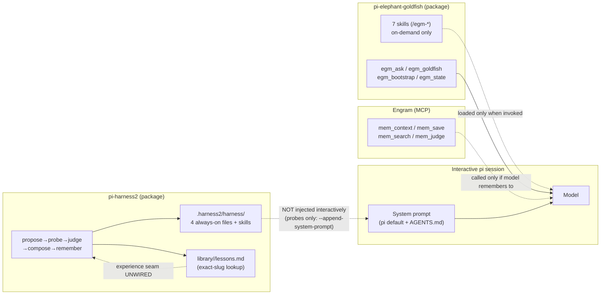
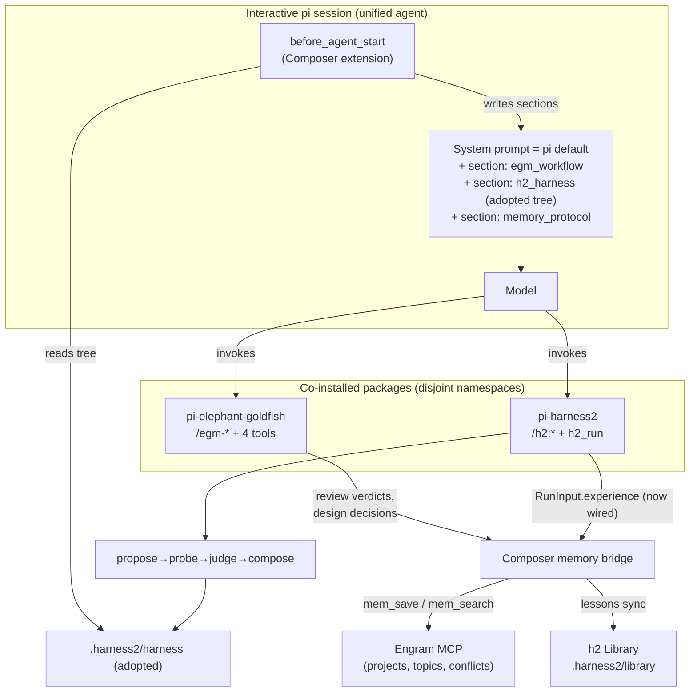
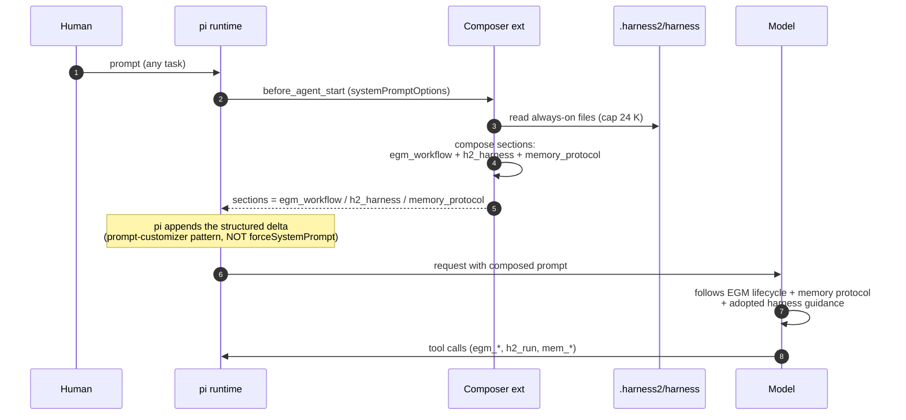
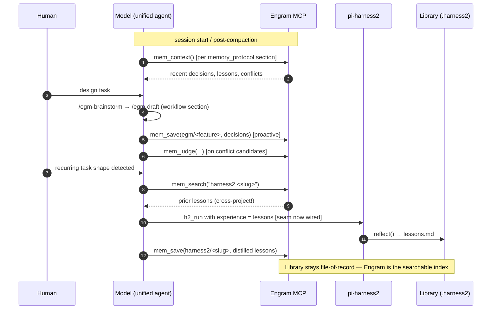
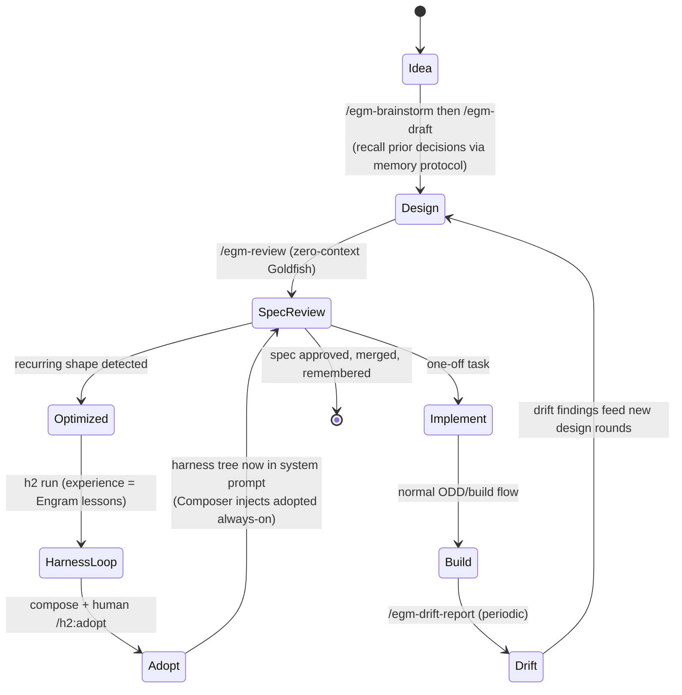

# RESEARCH: Unified Agent — EGM Workflow × Harness² Optimizer × Engram Memory

**Status:** Research proposal (read-only — no implementation authorized yet).
**Question:** Can the workflows of three independent systems be injected into the pi system prompt to compose one agent that works with all three?
**Systems:**
1. `pi-elephant-goldfish` (this repo) — EGM spec-driven design + zero-context review layer
2. `../pi-harness2` — the harness² method: propose → probe → compose → remember loop that adapts a harness tree per task
3. **Engram** — MCP memory layer (persistent, cross-session, project-scoped)

---

## 1. The three systems, as they stand today

### 1.1 pi-elephant-goldfish — the *workflow* layer

| Aspect | Mechanism (verified in this repo) |
|---|---|
| Workflow discipline | EGM lifecycle lives in **skill prose** (`/egm-brainstorm → /egm-draft → /egm-review → /egm-resolve → /egm-drift-report`), model-executed; `disable-model-invocation: true` so skills run only via explicit command |
| Capabilities | 4 extension tools: `egm_ask` (single-select gates), `egm_goldfish` (zero-context reviewer fan-out via headless `pi --print --no-session --tools read,grep,find,ls`), `egm_bootstrap` (recursive documentation swarm), `egm_state` (branch-aware pipeline state) |
| Artifacts | `concepts_brief.md`, design drafts, `*_report.md`, `bootstrap_report.md` — artifact-first, never chat dumps |
| Memory | None (by design — state files + session only) |
| System-prompt presence | **Only skill names + descriptions** (and only when `disable-model-invocation` is honored — pi hides them from the model entirely; commands are user-invoked). No workflow contract in the prompt |

**Gap:** the model has no standing knowledge that the EGM workflow exists, when to prefer it, or what the lifecycle is. The human must invoke every step.

### 1.2 pi-harness2 — the *capability-optimization* layer

Verified mechanical map (scout report, file:line referenced):

- **Harness tree** = `Record<relpath, content>` living in `.harness2/harness/`; 4 **always-on** files (`systemprompt.md`, `guardrails.md`, `LongTermMEMORY.md`, `tool_descriptions/tool_guidance.md`) joined and capped at **24,000 chars**, plus `skills/`, `scripts/`, `.pi/extensions/` stubs.
- **Loop**: `propose` (two lenses: general-procedure + domain-practitioner) → `probe` (headless `pi --print --mode json --no-extensions --append-system-prompt <file>` in throwaway workspaces) → `judge` (deliverable-only scoring; **"unavailable ≠ zero"** invariant) → `compose` (anonymized candidates merged by an LLM composer, `KEEP_BASE` allowed) → `remember` (per-task `library/<slug>/lessons.md`, OKF-publishable with machine-confirmable trust tiers).
- **Critical injection fact:** the tree reaches models **only in child probes** (`--append-system-prompt`) and channel calls (`--system-prompt`, which **replaces**). **The interactive session is never shaped by the tree** — mirroring to AGENTS.md/`.agents/skills/` is a documented manual step; `/h2:export` is "planned, not shipped" (docs/GENTLE-AI.md).
- **Unwired seam (scout-verified):** `RunInput.experience` exists (`recursion.ts:102`, consumed at `:320` propose and `:392` compose) **but `runHarness` never populates it** — the library's lessons are designed to feed future runs and currently don't.
- **Injectable by design:** `HarnessDeps`/`RecursionDeps` (all five model-touching steps are injectable), `h2_run` tool, `RunInput.rubric`, `channelModel`/`piBin` knobs.

**Gap:** same as EGM — the adopted tree does not shape the session the human actually works in; and its memory is file-exact-slug, with no search, no cross-project recall.

### 1.3 Engram — the *memory* layer

- MCP server; core tools: `mem_save` (proactive capture with topic keys, conflict-judging flow via `mem_judge`), `mem_search`, `mem_context` (recent history; intended **at session start and after compaction**), `mem_session_summary` (mandatory before "done"), `mem_get_observation`, `mem_current_project` (cwd-scoped projects), plus pinning/update/review deferred tools.
- Trust/lifecycle metadata per observation; conflict surfacing is a first-class protocol (candidates + `mem_judge` verdicts).
- **Gap:** nothing calls `mem_context` automatically; capture discipline depends on the model remembering the protocol — exactly the kind of standing instruction a system prompt should carry.

### 1.4 The composition insight

```
pi-harness2 answers:   "What should the agent's harness BE for this task shape?"   (optimizer)
pi-elephant-goldfish:  "How should the agent DESIGN and REVIEW work?"              (workflow)
Engram answers:        "What does the agent REMEMBER across sessions?"             (memory)
```

None of the three touches the interactive system prompt today. The missing piece is a **composer** — a small extension that assembles system-prompt sections from all three at `before_agent_start`, which is pi's native, structured mechanism for exactly this (`event.systemPromptOptions.sections.<name> = text`, per `examples/extensions/prompt-customizer.ts`; pi appends the delta and keeps the structured transcript — preferred over `forceSystemPrompt` replacement).

---

## 2. Current state (before)



Dashed edges are the three broken/intended links this research proposes to connect.

---

## 3. Proposed architecture (after)

**New component: the Composer** (working name `pi-unified` — a small fourth package, or a contribution into pi-harness2; decision in §7). One extension, ~300 lines, three responsibilities:

1. **Workflow injection** (`before_agent_start`): writes named sections —
   - `egm_workflow` (~2 KB): the lifecycle contract — "for feature/design work use /egm-brainstorm → /egm-draft → /egm-review → /egm-resolve; drift via /egm-drift-report; never self-review in-context; artifacts over chat."
   - `h2_harness`: the **adopted** always-on tree content, read from `.harness2/harness/` (joined, capped at h2's own 24 K budget) — this is effectively the missing `/h2:export`, delivered live instead of mirrored.
   - `memory_protocol` (~1 KB): the Engram discipline — call `mem_context` at session start/compaction; `mem_save` proactively after decisions; judge conflicts via `mem_judge`; `mem_session_summary` before done.
2. **Memory bridge (Engram ↔ h2 experience seam):**
   - On `h2:run` start: fetch prior lessons — `mem_search("harness2 <task-slug>")` + Library lookup — and populate `RunInput.experience` (the designed, unwired seam).
   - On run completion: `reflect()` output → also `mem_save(topic_key: "harness2/<slug>", type: "lesson")` so lessons become searchable cross-project, not file-exact.
   - EGM side: review verdicts and design decisions become `mem_save` observations (topic `egm/<feature>`); future `/egm-draft` runs can `mem_search` prior decisions.
3. **Compat guards:** enforce the disjoint-state contract (`odd/` vs `.harness2/` vs Engram project scoping), and surface h2's leak-guard vocabulary conflict (§5) before it throws.



---

## 4. System-prompt assembly flow



**Budget discipline:** pi default prompt + skills hints + 24 K h2 tree + ~3 K composer sections. The composer must truncate h2 content to its own cap and keep its own sections lean; measured cost lands in the normal context usage readout.

---

## 5. Memory loop (Engram as the unified memory layer)



Bridge rule (respecting h2's OKF trust tiers): Engram observations created from h2 lessons carry `verified` only when the run's best verdict is `pass ≥ 0.8` — same rule as `emitLesson`/`lessonVerdict`.

---

## 6. Combined task lifecycle (the "full agent")



The two systems cover each other's weak spot: **EGM reviews designs but never tunes the agent; harness² tunes the agent but (by its own docs) must not be used as a deliverable reviewer** (docs/GENTLE-AI.md: "Do not use h2 as a deliverable reviewer"). The unified agent uses each for what it is good at.

---

## 7. Feasibility & conflict matrix

| # | Conflict / constraint (scout-verified) | Impact on composition | Mitigation |
|---|---|---|---|
| C1 | h2 `PI_SURFACE` is a singleton (4 fixed always-on files, 24 K cap) | Composer must write the **same** convention, not a new format | Composer reads, never redefines; both sides share `tree.ts` semantics |
| C2 | `/h2:adopt` **replaces** `.harness2/harness/` (rmSync + rewrite) | Foreign files in that dir get deleted | Composer stores nothing in the tree dir; it reads at prompt time |
| C3 | h2 **leak-guard throws** on tasks containing "benchmark/evaluation/grader/rubric/**score**" — and EGM vocabulary is review-heavy ("review", "critic") | `h2:run "improve design review harness"` would throw at mission build | Composer pre-screens task text for the guard list and rewrites/splits, or calls `runHarness` programmatically with sanitized task text; upstream relaxation is a candidate PR |
| C4 | Probe isolation is **vanilla pi** (`--no-extensions`) — by design, docs forbid "fixing" | Lessons learned encode a bare-pi agent; EGM-tool-bearing sessions differ | Keep isolation (it measures the tree, not the environment); document that h2 optimizes the *prompt-and-skills* layer, which IS what probes see (`--append-system-prompt` + staged skills) |
| C5 | Skills in the tree load **only in probes**; live sessions need manual mirror | "Why doesn't my adopted skill run?" confusion | Composer's `/h2:export` equivalent: mirror `skills/` → `.agents/skills/` on adopt (the planned-but-unshipped feature) |
| C6 | `--system-prompt` (channel) **replaces**; `before_agent_start` section-append is the safe interactive mechanism | Composition must never reuse h2's channel pattern for the session | Composer uses sections only (prompt-customizer pattern) |
| C7 | Engram conflict protocol requires `mem_judge` verdicts; project scoping by cwd | Lessons synced from h2 land in the project of the cwd — cross-project recall needs explicit `all_projects` search | Memory protocol section instructs `all_projects` search for harness lessons; topic keys `harness2/<slug>` |
| C8 | h2 pins pi 1.3.0 CLI contract ("do not improvise"); this repo validated on 1.4.0 | Flag args could drift | Composer adds a startup compat probe (one cheap `--mode json` handshake) or pins docs |
| C9 | Prompt budget | Default prompt + 24 K tree + sections | Composer truncates and reports section sizes; h2 cap already enforces the big one |

**Verdict:** feasible without modifying either package's core. The only upstream-change candidates (nice-to-have, not required): wiring `experience` in `runHarness`, shipping `/h2:export`, relaxing the leak-guard vocabulary.

---

## 8. Implementation sketch (if approved later — NOT part of this research)

| Phase | Deliverable | Size |
|---|---|---|
| P0 | `pi-unified` package scaffold; composer extension reading `.harness2/harness` + writing 3 sections; budget guard | S |
| P1 | Memory protocol section + session-start `mem_context` discipline validated live | S |
| P2 | Engram ↔ h2 bridge: populate `RunInput.experience` (programmatic `runHarness` call), sync `reflect()` lessons to Engram with trust-tier rule | M |
| P3 | `/unified:adopt` = adopt + mirror skills to `.agents/skills/` + prompt refresh (the missing `/h2:export`) | M |
| P4 | EGM memory integration: design decisions + review verdicts as observations; `/egm-draft` recall | M |
| P5 | Tests: composer budget, section shape, bridge contracts; docs + diagrams | S |

---

## 9. Open questions (product decisions — owner: you)

1. **Where does the Composer live?** New package (`pi-unified`) vs. contributing the composer + export into `pi-harness2` upstream (it is MIT-licensed and the seam is theirs).
2. **Does h2 keep probe isolation?** Recommended yes (C4) — but confirm you don't want EGM-aware probes.
3. **Memory scope:** are harness lessons searchable across all projects (`all_projects`), or scoped per project?
4. **Leak-guard:** sanitize-and-proceed (C3) vs. upstream PR to soften the vocabulary tripwire?
5. **Adopt semantics:** should `/unified:adopt` also mirror skills live (C5), accepting that tree skills then affect ALL sessions, not just h2 runs?

---

## 10. Sources

- Scout report on pi-harness2 (13 src files, 3 docs, tests, odd/ history; file:line citations in §1.2)
- This repo: PLAN.md, TESTING.md, extensions/ source (phases 0–6)
- pi docs: extensions.md (`before_agent_start`, sections vs `forceSystemPrompt`), skills.md, packages.md; `examples/extensions/prompt-customizer.ts`
- Engram MCP server instructions (core/deferred tools, proactive-save rule, conflict protocol, delivery guarantee)
